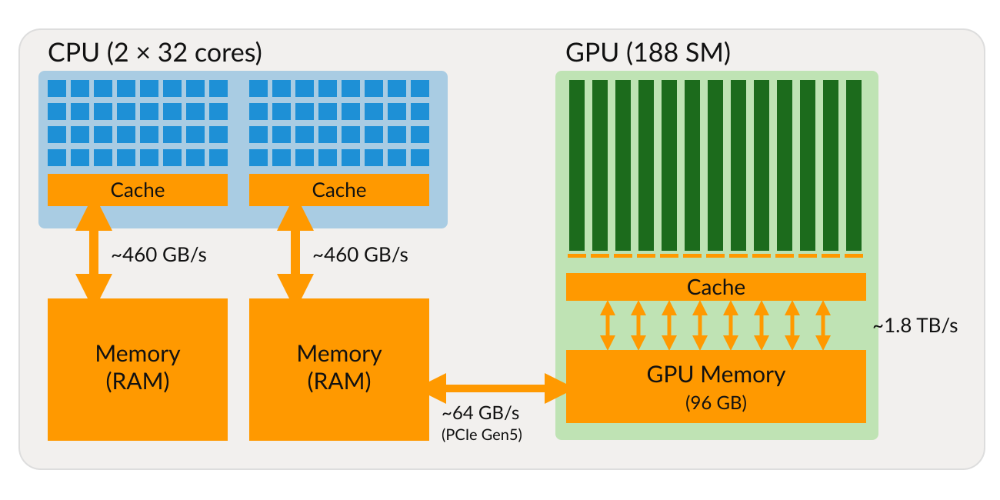
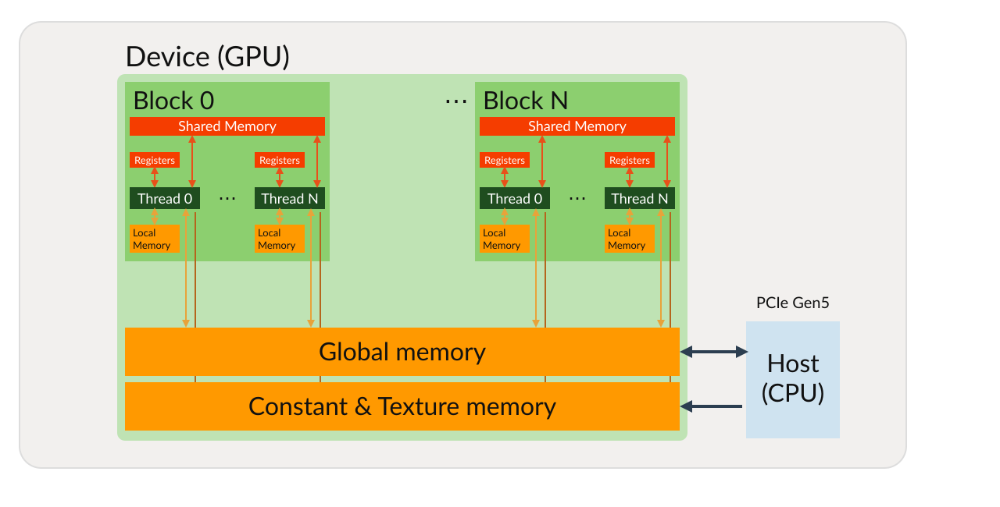
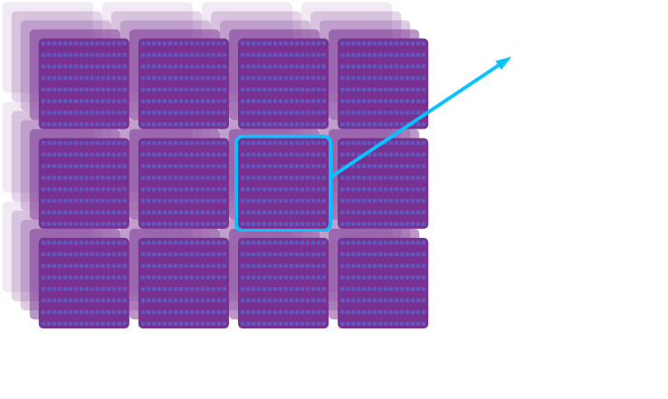
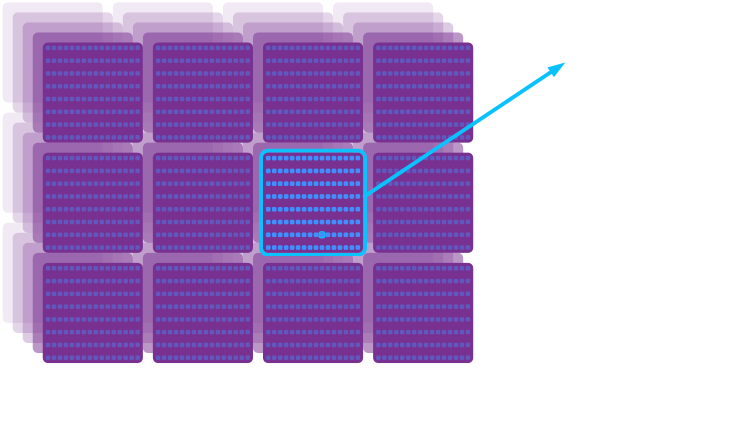
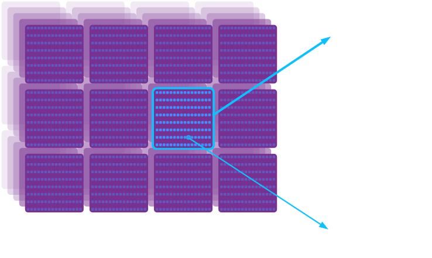

name: title
class: center, middle
layout: true
---
template: title

# The Aphroditi HPC System and Running GPU Workloads

.red[\\\\\\]

.venue[

Introduction to GPU Computing on HPC Systems: From CPUs to Accelerators

13$^{th}$ November 2026

]

.red[\\\\\\]

.speaker[

Giannis Koutsou,

]

.sub[

Computation-based Science and Technology Research Center,

The Cyprus Institute

]
---
name: normal
layout: true
---

# Outline

### Part 1 (09:35): The Aphroditi HPC system
- System overview: CPU and GPU resources
- Architecture of the RTX partition's CPUs and GPUs
- Using Aphroditi: logging in, the job scheduler, the build environment

### Part 2 (10:00): Running GPU workloads on HPC systems
- How work is organised on a GPU: threads and blocks
- Batch scripts and requesting GPU resources
- Hands-on: CPU vs GPU performance, and using the GPU efficiently

--

### Assumptions about this hands-on session

- Some familiarity with programming in C or C++
- Familiarity with some common command-line tasks, e.g. navigating the file system
- You can edit a text file in a terminal, e.g. with `nano` (easiest), `vim`, or `emacs`

--

Ways of accessing these slides and the exercises:
- Slides, via web browser: [castorc-cyi.github.io/NCC-training-202611](https://castorc-cyi.github.io/NCC-training-202611/)
- Exercises, on GitHub: [github.com/CaSToRC-CyI/NCC-training-202611](https://github.com/CaSToRC-CyI/NCC-training-202611) (also on Aphroditi, under `/onyx/data/edu30/`)

---
template: title

# Part 1: The Aphroditi HPC System

---
template: normal

# The Aphroditi HPC System

<style type="text/css">
	img[alt=cluster]{width: 45%; float: center; padding: 5px}
</style>

.center[]

### Aphroditi: AI-training-focused servers at The Cyprus Institute
- B200 cluster: 2 nodes, each with 8$\times$NVIDIA B200 GPUs (192 GBytes each)
- RTX6000 cluster ("RTX partition"): 6 nodes, of which 2 are reserved for this training
  - Hostnames: `rtx6001`, `rtx6002`
  - 2$\times$32-core AMD EPYC 9333 (64 cores per node)
  - 1 TByte RAM
  - 8$\times$NVIDIA RTX PRO 6000 Blackwell GPUs with 96 GBytes graphics memory each
- Common storage for our course: `/onyx/data/edu30/`

---
# GPU architecture

At a very high level:

<style>
      img[alt=gpu] { width: 50%; margin-left: 10%; margin-right: 10%;}
</style>

.center[]

.left-column[
### CPU
- Few heavy cores
- Large memory
- Moderate BW to memory
- Optimized for serial execution
]

.right-column[
### GPU
- Many light "cores"
- Smaller memory
- High BW to memory
- Optimized for parallel execution
]

---
# GPU programming model


.center[]

### Some numbers from the RTX partition of Aphroditi
**NVIDIA RTX PRO 6000** _Blackwell_ GPUs
- 188 Streaming Multiprocessors (SM) per GPU
- 128 "cores" per SM (24064 in total)
- GPU memory: 96 GBytes
- Memory bandwidth: $\sim$1.8 TB/s
- Peak performance: $\sim$126 Tflop/s (single precision)

--

.red[We will come back to these numbers during the hands-on]

---
# GPU programming model

.center[]

### "Offload" model of programming
- CPU starts program (runs `main()`)
- CPU copies data to GPU memory (over PCIe, ~64 GB/s)
- CPU dispatches "kernels" for execution on GPU
  - Kernels read/write to GPU memory (~1.8 TB/s)
  - Kernels run on GPU threads (thousands) which share *fast* memory
    [$\mathcal{O}$(10) times faster compared to GPU memory]
- Kernel completes; CPU copies data back from GPU (over PCIe, ~64 GB/s)

---
# GPU programming model

.center[]

### GPU memory model (NVIDIA model)
- GPU threads: *slow* access to global, constant, and texture memory
- Each thread has *registers* (fast) and *local memory* (slow)
- Threads are grouped into *blocks*; Threads within the same block: *shared memory* (fast)
- Shared memory is limited. E.g. 48 KB per block by default (up to 99 KB on request) for the RTX PRO 6000

---
# GPU programming model

.center[]

### GPU memory model (NVIDIA model); some numbers for context
- Threads per block: 1024 (max)
- Registers (per block): 64 K (32-bit)
- Shared memory (per block): 48 KB by default, up to 99 KB
- Also, max. 255 registers per thread

---
# GPU programming model

.center[]

### GPU memory model (NVIDIA model)
- Assumptions about execution order
  - Threads within the same block can be assumed to run concurrently
  - No assumption about the order by which blocks are executed

---
template: normal

# Using Aphroditi

- Log in to a _login node_ or _frontend node_ $-$ login node in our case has hostname `front01`
- To run programs on _compute nodes_, a _job scheduler_ is available
- Distinguish between _interactive_ and _batch_ jobs

--

### SLURM job scheduler

- See currently running and waiting jobs: `squeue`
- Ask for an interactive job: `salloc`
- Submit a batch job: `sbatch`
- Run an executable: `srun`

---

template: normal

# Using Aphroditi: Introductory Example

- Log in: open the shell of `front01` in your web browser
--

	$\rightarrow$ Your Aphroditi account and login credentials were provided by the organisers before the training

--

- Type `hostname`. This tells you the name of the node you are currently logged into:
```zsh
[ikoutsou@front01 ~]$ hostname
front01
```
this is the login node.

--

- Ask for one node (`-N 1`):
```zsh
[ikoutsou@front01 ~]$ salloc -N 1 -p rtx --reservation=edu30 -A edu30 --gres=gpu:1
salloc: Granted job allocation 411146
salloc: Waiting for resource configuration
salloc: Nodes rtx6001 are ready for job
[ikoutsou@rtx6001 ~]$
```

--
	- `-A edu30`: charge project with name `edu30`

--
	- `--reservation=edu30`: use reservation `edu30` (reservation and project names need not be the same)

--
	- `-p rtx`: requests a node from the `rtx` partition $-$ the partition that includes all RTX nodes

--
	- `--gres=gpu:1`: request one GPU. Every job on the `rtx` partition must ask for at least one GPU

---
template: normal

# Using Aphroditi: Introductory Example


- Type `hostname` again:
```zsh
[ikoutsou@rtx6001 ~]$ hostname
rtx6001
```
`rtx6001` is the hostname of a compute node

--

- Release the node (type `exit` or hit `ctrl-d`):
```zsh
[ikoutsou@rtx6001 ~]$ exit
exit
salloc: Relinquishing job allocation 411146
salloc: Job allocation 411146 has been revoked.
[ikoutsou@front01 ~]$
```
we're back on `front01`

--

.center[.red[Please **do not** hold nodes unnecessarily; when you have nodes `salloc`ed you may be blocking other users from using those nodes.]]

--

- Use `srun` instead of `salloc`:
```zsh
[ikoutsou@front01 ~]$ srun -N 1 -p rtx -A edu30 --reservation=edu30 --gres=gpu:1 hostname
rtx6001
```

--

- Allocates a node, runs the specified command (in this case
`hostname`), and then exits the node, releasing the allocation

--

- The output, `rtx6001`, reveals that we were allocated node `rtx6001` for this specific $-$ very short $-$ job

---

template: normal

# Using Aphroditi: Introductory Example

- Run multiple instances of `hostname` in parallel:
```zsh
[ikoutsou@front01 ~]$ srun -N 1 -n 2 -p rtx -A edu30 --reservation=edu30 --gres=gpu:1 hostname
rtx6001
rtx6001
```
--
	- `-N 1`: use one node
	- `-n 2`: use two processes

--

- Run on more than one node:
```zsh
[ikoutsou@front01 ~]$ srun -N 2 -n 2 -p rtx -A edu30 --reservation=edu30 --gres=gpu:1 hostname
rtx6001
rtx6002
```
runs one instance of `hostname` on each node

--

- Try:
```zsh
[ikoutsou@front01 ~]$ srun -N 2 -n 1 -p rtx -A edu30 --reservation=edu30 --gres=gpu:1 hostname
```
--
```zsh
srun: Warning: can't run 1 processes on 2 nodes, setting nnodes to 1
rtx6001
```

---


template: normal

# Using Aphroditi: Introductory Example


- Make a directory. List it, see that it is there:
```zsh
[ikoutsou@front01 ~]$ mkdir eurocc-training
[ikoutsou@front01 ~]$ ls
eurocc-training
[ikoutsou@front01 ~]$ 
```

--
- Change into it:
```zsh
[ikoutsou@front01 ~]$ cd eurocc-training/
[ikoutsou@front01 eurocc-training]$ 
```

--
- `pwd` will tell you where you are in the file system:
```zsh
[ikoutsou@front01 eurocc-training]$ pwd
/nvme/h/ikoutsou/eurocc-training
```

--
- `/` is referred to as the _root directory_

--
- `.` is an alias for the _current directory_

--
- `..` is an alias for the directory one level above

--
- `~` is an alias for your _home directory_

--
- E.g.:
```zsh
[ikoutsou@front01 eurocc-training]$ cd ../../
[ikoutsou@front01 h]$ pwd
/nvme/h
```

---
template: normal

# Using Aphroditi: Introductory Example

- `cd` without any additional arguments takes you home (equivalent to `cd ~`)
```zsh
[ikoutsou@front01 h]$ cd
[ikoutsou@front01 ~]$ pwd
/nvme/h/ikoutsou
```

--

- Make a subdirectory under `eurocc-training` for our first C program
```zsh
[ikoutsou@front01 ~]$ cd eurocc-training
[ikoutsou@front01 eurocc-training]$ mkdir 01
[ikoutsou@front01 eurocc-training]$ cd 01
[ikoutsou@front01 01]$ 
```

--
- Copy the program from our shared space
```zsh
[ikoutsou@front01 01]$ cp /onyx/data/edu30/01/prog-01.c .
```

--

- Inspect the program with `cat`, or open it in a text editor, e.g. `nano` (exit `nano` with `ctrl-x`):
```zsh
[ikoutsou@front01 01]$ nano prog-01.c
```

--

- You do .red[not] need to change any C code in this training; all programs are ready to compile and run

---
template: normal

# Using Aphroditi: Introductory Example

```c
#include <unistd.h>           
#include <stdio.h>            
#include <sys/types.h>        


int
main(int argc, char *argv[])
{
  char hname[256];         
  pid_t p;                 
  gethostname(hname, 256); 
  p = getpid();            
  printf(" Hostname: %s, pid: %lu\n", hname, p); 
  return 0; 
            
}
```

---
template: normal

# Using Aphroditi: Introductory Example

```c
#include <unistd.h>           // <-- provides definitions for gethostname() and getpid()
#include <stdio.h>            // <-- provides definitions for printf()
#include <sys/types.h>        // <-- defines the pid_t type 
// main()
//   -> argv[] is an array of strings which holds all command line arguments
//   -> argc holds the number of elements of argv
int
main(int argc, char *argv[])
{
  char hname[256];         // <-- declare hname[] as an array of 256 characters (a string of length 256)
  pid_t p;                 // <-- declare p as a pid_t type, in this case, an unsigned long integer
  gethostname(hname, 256); // <-- call gethostname(), return hostname in hname which is 256 characters long
  p = getpid();            // <-- call getpid(), return value in p
  printf(" Hostname: %s, pid: %lu\n", hname, p); // print statement
  return 0; // <-- return a value of 0 to the operating system. By convention 0 means success.
            //     Non zero values indicate errors.
}
```

---
template: normal

# Using Aphroditi: Introductory Example

Time to _compile_ the program into an executable. 

--

- It is common on HPC systems, as is the case for this system, to have
  multiple versions and releases of software installed
  
--
  
- This is also the case for .blue[_build environments_], i.e. various versions
  of compilers, linkers, debuggers, and libraries
  
--
  
- The user can select the version that is available to them in each session via a so-called .blue[_modules system_]
  
--

- List all available modules (long listing truncated in this slide)

```zsh
[ikoutsou@front01 01]$ module avail
...
CUDA/12.9.1
CUDA/13.0.0
CUDA/13.1.0
...
GCC/14.3.0
GCC/15.2.0
...
gompi/2025b
gompi/2026.1
...
```

--

- `module list `  should show the currently loaded modules. In a fresh environment with no modules loaded, you should see:

```zsh
[ikoutsou@front01 01]$ module list
No modules loaded
```

--

- `module purge `  will unload all modules

---
# Using Aphroditi: Introductory Example

- We will be using the `gompi/2025b` module set. See info:

```zsh
[ikoutsou@front01 ~]$ module show gompi/2025b
...
```

--

- GNU C/C++ compilers (GCC 14.3)
- OpenMPI implementation of MPI library (not relevant here)
- .red[Note:] use version `2025b` explicitly; the newer default version does not run on `front01`

--

```zsh
[ikoutsou@front01 01]$ module load gompi/2025b
[ikoutsou@front01 01]$ module list
Currently Loaded Modules:
  1) GCCcore/14.3.0                  7) libxml2/2.14.3-GCCcore-14.3.0       13) libfabric/2.1.0-GCCcore-14.3.0
  2) zlib/1.3.1-GCCcore-14.3.0       8) libpciaccess/0.18.1-GCCcore-14.3.0  14) PMIx/5.0.8-GCCcore-14.3.0
  3) binutils/2.44-GCCcore-14.3.0    9) hwloc/2.12.1-GCCcore-14.3.0         15) PRRTE/3.0.11-GCCcore-14.3.0
  4) GCC/14.3.0                     10) OpenSSL/3                           16) UCC/1.4.4-GCCcore-14.3.0
  5) numactl/2.0.19-GCCcore-14.3.0  11) libevent/2.1.12-GCCcore-14.3.0      17) OpenMPI/5.0.8-GCC-14.3.0
  6) XZ/5.8.1-GCCcore-14.3.0        12) UCX/1.19.0-GCCcore-14.3.0           18) gompi/2025b
```
--

- To compile:

```zsh
[ikoutsou@front01 01]$ gcc prog-01.c -o p01
```
--
- `-o p01` means "name the resulting executable `p01`". If you don't
      specify `-o` the executable name defaults to `a.out`

---

template: normal

# Using Aphroditi: Introductory Example

- Type `ls` to make sure it has been created. Then run it on the frontend node:
```zsh
[ikoutsou@front01 01]$ ls
p01  prog-01.c
[ikoutsou@front01 01]$ ./p01
 Hostname: front01, pid: 1815924
```

--

- Run your new program `p01` using `srun` on one node with four processes

--
```zsh
[ikoutsou@front01 01]$ srun -N 1 -n 4 -p rtx --reservation=edu30 -A edu30 --gres=gpu:1 ./p01
 Hostname: rtx6001, pid: 62167
 Hostname: rtx6001, pid: 62168
 Hostname: rtx6001, pid: 62170
 Hostname: rtx6001, pid: 62169
[ikoutsou@front01 01]$
```

--
	4 processes ran .blue[_in parallel_] on `rtx6001`; each has a different process ID (`pid`)

--

- Now try two nodes, four processes in total (`-N 2 -n 4`). On which nodes did your processes run?

---
# Summary of Part 1

### Outline of major points covered

- Aphroditi's RTX partition: 64 CPU cores and 8 GPUs per node; GPUs with much higher memory bandwidth than the CPUs

- Job scheduling system for reserving and running on compute nodes

- Interactive jobs (`salloc`, `srun`)

- Modules system for selecting build environment

- Running copies of a program concurrently on multiple cores and multiple nodes

--

### Important points .blue[*not*] covered

- We ran several independent copies of an otherwise _scalar_ program

- We have not covered implementing parallelism and concurrency
  _within_ the programs, which is the standard approach in parallel
  computing

- Examples:

	- Multi-threading, using a shared memory paradigm. For example using OpenMP $\leftarrow$ .blue[we will _use_ this in the next part]
	- Distributed memory parallelization, e.g. using MPI

--

</br>
.center[**.red[Up next:] Part 2, running GPU workloads **]

---
template: title

# Part 2: Running GPU Workloads on HPC Systems

---

# Outline of Part 2

### Some slides on:

- How work is organised on a GPU: threads and blocks

--

### Hands-on $-$ practical examples

Two ready-made programs, which you will run via _batch scripts_ that request CPU and GPU resources:
- `axpy-cpu`: a simple operation on the CPU, multi-threaded with OpenMP
- `axpy-gpu`: the same operation on the CPU _and_ on the GPU

You will change the number of CPU threads and of GPU threads per block, and compare performance

--

Not covering:
- Writing CUDA code yourself, the CUDA API
- Shared memory, warps and thread scheduling
- When and why to use GPUs, in more depth $\leftarrow$ next session, after the coffee break

---
# CUDA programming model

### NVIDIA programming framework for NVIDIA GPUs
- Compute Unified Device Architecture
- C-like programming language for writing *CUDA Kernels*
  - Includes C/C++ and Fortran variants
  - Compiler for  C/C++: `nvcc`
- Functions for transferring data to/from GPUs, starting kernels, etc.
- Some higher-level functionality also available (linear algebra, random number generations,  etc.)
- Concepts generalizable to other accelerator programming frameworks (OpenCL, OpenACC, HIP, etc.)

--

### Nomenclature
- "Host" is the CPU
- "Device" is the GPU

---
# CUDA programming basics

### Declare a CUDA kernel

Example:
```C
__global__ void
func(int n, double a, double *x)
{
	...
	return;
}
```

### Call a CUDA kernel

- Call from host. Example:
```c
func<<<nblck, nthr>>>(n, a, x);
```

- `nthr`: number of threads per block; can be scalar or a `dim3` type
- `nblck`: number of blocks; can be scalar or a `dim3` type


--
- Example of `dim3` type:
```C
dim3 nthr(1024, 8, 8); /* No. of threads in (x, y, z) */
```

---
# CUDA programming basics

### Call a CUDA kernel

- Call from host. Example:
```C
func<<<nblck, nthr>>>(n, a, x);
```

- `nthr`: number of threads per block; can be scalar or a `dim3` type
- `nblck`: number of blocks; can be scalar or a `dim3` type
- Example of `dim3` type:
```C
dim3 nthr(1024, 8, 8); /* No. of threads in (x, y, z) */
```

### Thread coordinates within kernel

Example:

```C
__global__ void
func(int n, double a, double *x)
{
	int idx = threadIdx.x + blockIdx.x*blockDim.x;
	...
	return;
}
```

---
name: blkthrds
layout: true

<style>
	img[alt=gpux] { width: 47.5%; margin-left: 5%; margin-right: 5%;}
</style>


# CUDA programming basics

### Threads, blocks, grids

```c
dim3 blcks( 4, 3, bz);
dim3 thrds(16, 8, tz);
func<<<blcks, thrds>>>(...);

```
---
template: blkthrds
.center[]
---
template: blkthrds
.center[]
---
template: blkthrds
.center[]
---
template: blkthrds
.center[]
---
template: blkthrds
.center[]
---
template: blkthrds
.center[]
---
template: blkthrds
.center[]
---
template: blkthrds
.center[]

### Variables available within kernel
.left-column[
- `threadIdx.{x,y,z}`
- `blockIdx.{x,y,z}`
]
.right-column[
- `blockDim.{x,y,z}`
- `gridDim.{x,y,z}`
]

---
name: normal
layout: true
---
template: normal

# Hands-on: the "axpy" operation

Both programs of the hands-on implement a so-called "axpy" operation (a-times-x-plus-y):

$$
y_i \leftarrow a\cdot x_i + y_i,\,\,\,i=0,...,n-1
$$

with $a$ scalar and $y$ and $x$ vectors of length $n$.

--

- For each element: 2 floating point operations (one multiplication, one addition)

--

- For each element: 3 memory accesses of 4 bytes each (read `x[i]`, read `y[i]`, write `y[i]`), single precision

--

- Very little computation for each byte read or written $\Rightarrow$ performance is limited by .blue[_memory bandwidth_]

--

- So: we will report performance in .blue[GB/s] and compare to the peak memory bandwidth of the hardware

--

Two examples:
1. `axpy-cpu`: axpy on the CPU, using OpenMP for multi-threading
2. `axpy-gpu`: axpy on the CPU _and_ on the GPU, for comparison

--

In both cases, you will only edit the .blue[_batch script_] used to run the program

---
# Example 1: `axpy-cpu`

- Copy the exercise from the shared space:

```shell
[ikoutsou@front01 01]$ cd ~/eurocc-training
[ikoutsou@front01 eurocc-training]$ mkdir 02
[ikoutsou@front01 eurocc-training]$ cd 02
[ikoutsou@front01 02]$ cp /onyx/data/edu30/02/* .
[ikoutsou@front01 02]$ ls
axpy-cpu.c  axpy-cpu.sh
```

--

- `axpy-cpu.c`: the program. Feel free to inspect it (`cat` or `nano`). The important part:

```C
void
axpy(long n, float a, float *x, float *y)
{
#pragma omp parallel for
  for(long i=0; i<n; i++)
    y[i] = a*x[i] + y[i];
  return;
}
```

--

- `#pragma omp parallel for`: OpenMP splits the iterations of the loop
  between the available CPU threads. The number of threads is set at
  run-time via the environment variable `OMP_NUM_THREADS`

--

- The program runs `axpy()` 10 times and reports the average time,
  the performance (Gflop/s), and the memory bandwidth achieved (GB/s)

---
# Example 1: `axpy-cpu`

- Compile with OpenMP enabled (`-fopenmp`) and optimizations (`-O3`):

```shell
[ikoutsou@front01 02]$ module load gompi/2025b
[ikoutsou@front01 02]$ gcc -O3 -fopenmp -o axpy-cpu axpy-cpu.c
```

--

- We will now run using a .blue[_Slurm batch script_] as opposed to
  running .blue[_interactively_] which we have been doing so far

--

- A batch script is a shell script that Slurm runs for us on a compute
  node, once the resources we ask for become available

--

- We submit it, and can then log out or do other work; the output is written to a file

---
# Example 1: `axpy-cpu`

- The batch script `axpy-cpu.sh`:

.small[
```sh
#!/bin/bash
#SBATCH -J axpy-cpu
#SBATCH -o axpy-cpu.txt
#SBATCH -e axpy-cpu.err
#SBATCH -p rtx
#SBATCH -A edu30
#SBATCH --reservation=edu30
#SBATCH -t 00:05:00
#SBATCH -N 1
#SBATCH -n 1
#SBATCH --cpus-per-task=8
#SBATCH --gres=gpu:1

export OMP_PLACES=cores
export OMP_PROC_BIND=close
export OMP_NUM_THREADS=1      # <-- EDIT ME: try 1, 2, 4, 8

N=$((1024*1024*64))
srun --cpus-per-task=$SLURM_CPUS_PER_TASK ./axpy-cpu $N
```
]

--

- The lines starting with `#SBATCH` are parsed by Slurm, even though
  they are ignored as comments by bash. The options are the same as you would pass to `srun`

--

- `-J`: job name; `-o` and `-e`: files for output and errors; `-t`: maximum run time (5 minutes)

--

- `--cpus-per-task=8`: reserve 8 CPU cores (one GPU's share of a node; the GPU is required by the `rtx` partition, but not used here)

- `srun --cpus-per-task=$SLURM_CPUS_PER_TASK`: run the program on those 8 cores. `OMP_PLACES`, `OMP_PROC_BIND`: keep each thread on its own core

---
# Example 1: `axpy-cpu`

- Submit the script via `sbatch`:
```sh
[ikoutsou@front01 02]$ sbatch axpy-cpu.sh
Submitted batch job 411152
```

--

- Check status via `squeue`:
```sh
[ikoutsou@front01 02]$ squeue -u $USER
             JOBID PARTITION     NAME     USER ST       TIME  NODES NODELIST(REASON)
            411152       rtx axpy-cpu ikoutsou  R       0:01      1 rtx6001
```

--

- `R` means "Running". You may see `PD` for "Pending" (not yet
  running) or `CG` for "Completing"

--

- When the job has finished, `squeue -u $USER` should not show any jobs

--

- The output is now in `axpy-cpu.txt` (which was specified in the batch script). Any errors will be in `axpy-cpu.err`

--

- Check the output:
```sh
[ikoutsou@front01 02]$ cat axpy-cpu.txt
 CPU: nthr =    1   t0 =   0.010564 sec   P =     12.705 Gflop/s   B =     76.231 GB/s
```

---
# Example 1: `axpy-cpu`

### Exercise: vary the number of CPU threads

- Edit `axpy-cpu.sh` (e.g. `nano axpy-cpu.sh`), change `OMP_NUM_THREADS` to 2, 4, and 8
- Each time: save, submit with `sbatch`, wait for the job to finish, and `cat axpy-cpu.txt`
- Note down the bandwidth (`B = ... GB/s`) for each case

--

- What I got:

.small[
```
 CPU: nthr =    1   t0 =   0.010564 sec   P =     12.705 Gflop/s   B =     76.231 GB/s
 CPU: nthr =    2   t0 =   0.007437 sec   P =     18.047 Gflop/s   B =    108.284 GB/s
 CPU: nthr =    4   t0 =   0.007253 sec   P =     18.505 Gflop/s   B =    111.032 GB/s
 CPU: nthr =    8   t0 =   0.007277 sec   P =     18.444 Gflop/s   B =    110.665 GB/s
```
]

--

- How does the bandwidth scale with the number of threads?

--

- Already with 2 threads the bandwidth levels off at $\sim$110 GB/s

--

- Compare to the peak memory bandwidth of one CPU socket, $\sim$460 GB/s. We
  are using only 8 of its 32 cores. The CPU is built from several "chiplets" of 8 cores each,
  and the link between one chiplet and memory limits the bandwidth our 8 cores can get

---
# Example 2: `axpy-gpu`

- Copy the exercise from the shared space:

```shell
[ikoutsou@front01 02]$ cd ~/eurocc-training
[ikoutsou@front01 eurocc-training]$ mkdir 03
[ikoutsou@front01 eurocc-training]$ cd 03
[ikoutsou@front01 03]$ cp /onyx/data/edu30/03/* .
[ikoutsou@front01 03]$ ls
axpy-gpu.cu  axpy-gpu.sh
```

--

- `axpy-gpu.cu` is a CUDA program. It:
  - fills `x` and `y` with random numbers (two copies of each)
  - **A:** runs axpy on the CPU (as in Example 1), reports performance
  - **B:** copies `x` and `y` to the GPU, runs axpy on the GPU, reports performance, copies `y` back
  - reports the difference between the CPU and GPU results (`Diff`), which should be very small

--

- Two command-line arguments: the vector length `N`, and the number of GPU threads per block `NTHR`

---
# Example 2: `axpy-gpu`

The GPU kernel. .blue[One GPU thread per element of `y`]:

```C
__global__ void
gpu_axpy(long n, float a, float *x, float *y)
{
  long idx = threadIdx.x + (long)blockIdx.x*blockDim.x;
  if(idx < n)
    y[idx] = a*x[idx] + y[idx];
  return;
}
```

--

and how it is called:

```C
    long nblck = (n + nthr - 1)/nthr;
    ...
    gpu_axpy<<<nblck, nthr>>>(n, a, d_x, d_y);
```

--

- `nthr` threads per block, taken from the command line

--

- `nblck` blocks: enough blocks so that `nblck`$\times$`nthr` $\ge$ `n`

--

- `idx`: each thread computes which element it is responsible for, from its block and thread index (recall the threads/blocks slides)

--

- `if(idx < n)`: the last block may have more threads than remaining elements

---
# Example 2: `axpy-gpu`

- Compile with `nvcc`, the CUDA compiler:

```shell
[ikoutsou@front01 03]$ module load gompi/2025b
[ikoutsou@front01 03]$ module load CUDA
[ikoutsou@front01 03]$ nvcc -O3 -arch=sm_120 -Xcompiler -fopenmp -o axpy-gpu axpy-gpu.cu
```

--

- `-arch=sm_120`: compile for the "compute capability" of the RTX PRO 6000 Blackwell GPUs

- `-Xcompiler -fopenmp`: tells `nvcc` to pass `-fopenmp` to the underlying C compiler (here `gcc`), for the CPU part

--

- The batch script `axpy-gpu.sh`:

.small[
```sh
...                           # same #SBATCH lines as axpy-cpu.sh, with -J, -o, -e changed

export OMP_PLACES=cores
export OMP_PROC_BIND=close
export OMP_NUM_THREADS=8      # <-- EDIT ME: CPU threads, try 1, 2, 4, 8
NTHR=1024                     # <-- EDIT ME: GPU threads per block, try 1, 32, 64, ..., 1024

N=$((1024*1024*64))
srun --cpus-per-task=$SLURM_CPUS_PER_TASK ./axpy-gpu $N $NTHR
```
]

---
# Example 2: `axpy-gpu`

- Submit and check the output once complete:

```sh
[ikoutsou@front01 03]$ sbatch axpy-gpu.sh
Submitted batch job 411156
[ikoutsou@front01 03]$ cat axpy-gpu.txt
 CPU: nthr =    8                        t0 =   0.007229 sec   P =     18.567 Gflop/s   B =    111.399 GB/s
 GPU: nthr = 1024   nblck =      65536   t0 =   0.000545 sec   P =    246.324 Gflop/s   B =   1477.947 GB/s
 Diff = 7.371814e-15
```

--

- The GPU is $\sim$13$\times$ faster than the 8 CPU cores, and the small `Diff` confirms that both give the same result

--

- Compare to the peak memory bandwidth of the GPU, $\sim$1.8 TB/s

---
# Example 2: `axpy-gpu`

### Exercise: vary the number of GPU threads per block

- Edit `axpy-gpu.sh`, change `NTHR`, e.g. to 1, 2, 32, 64, 128, 256, 512, 1024
- Each time: save, submit with `sbatch`, and once done, `cat axpy-gpu.txt`

--

- What I got:

.small[
```
 GPU: nthr =    1   nblck =   67108864   t0 =   0.038189 sec   P =      3.515 Gflop/s   B =     21.087 GB/s
 GPU: nthr =   32   nblck =    2097152   t0 =   0.001197 sec   P =    112.099 Gflop/s   B =    672.594 GB/s
 GPU: nthr =  128   nblck =     524288   t0 =   0.000539 sec   P =    248.818 Gflop/s   B =   1492.906 GB/s
 GPU: nthr =  512   nblck =     131072   t0 =   0.000539 sec   P =    249.016 Gflop/s   B =   1494.095 GB/s
 GPU: nthr = 1024   nblck =      65536   t0 =   0.000545 sec   P =    246.324 Gflop/s   B =   1477.947 GB/s
```
]

--

- 1 thread per block: very slow. Each block is scheduled on an SM as a unit; with one thread per block most of each SM is idle
- 32 threads per block: much better, but not yet at the best performance
- $\ge$128 threads per block: $\sim$1.5 TB/s, i.e. $\sim$83% of the peak bandwidth

--

- Try `NTHR=2048`. What happens? (Recall the max. number of threads per block)

---
# Summary

### Main points covered
- Job scheduling: interactive jobs (`salloc`, `srun`) and batch jobs (`sbatch`, `squeue`)
- Modules system for selecting the build environment
- GPU architecture, and how work on a GPU is organised in threads and blocks
- CPU vs GPU performance for a memory-bandwidth-bound operation
- Effect of the number of CPU threads and of GPU threads per block

--

### Major points that were .red[not] covered
- Writing CUDA kernels; the CUDA API for memory allocation and data transfer
- _Shared memory_: memory that can be shared between GPU threads in the same block
- _Thread scheduling_
  - Thread synchronization 
  - Thread warps
  - Considerations when using control flow constructs (e.g. `if`-statements)
